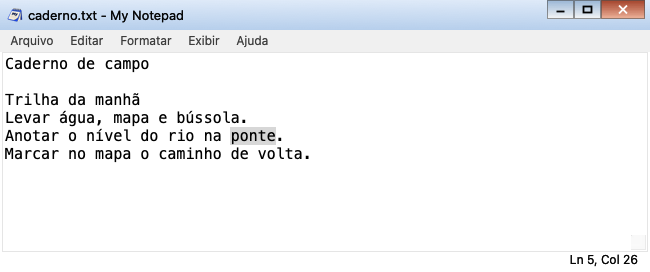

# My Notepad

**Português (Brasil)** · [English](docs/readme/en.md) · [Español](docs/readme/es.md) · [Français](docs/readme/fr.md) · [Deutsch](docs/readme/de.md) · [Italiano](docs/readme/it.md) · [日本語](docs/readme/ja.md) · [한국어](docs/readme/ko.md)

Um editor de texto simples para macOS inspirado no Bloco de Notas do Windows 7. Abra um .txt, escreva e salve com os atalhos que suas mãos já conhecem.



## Por que este projeto existe?

O My Notepad nasceu de uma saudade específica de quem trocou o Windows pelo Mac. Para anotar um endereço ou corrigir uma linha de um arquivo antigo, bastavam uma janela, cinco menus e o cursor. O projeto recupera esse jeito de trabalhar em Swift e AppKit. Cada janela edita um documento, e a fonte escolhida vale para a visualização. O arquivo continua sendo texto simples.

## No dia a dia

- Localize e substitua texto mantendo a busca aberta. Com a quebra automática de linha desativada, use **Editar → Ir para…** para saltar até uma linha ou ative **Exibir → Barra de status** para acompanhar linha e coluna.
- Abra arquivos em Windows-1252, UTF-8 ou UTF-16 (LE e BE). O editor reconhece terminações de linha do Windows, macOS e Unix. Se a codificação escolhida não comportar um caractere, oferece salvar em UTF-8.
- Ajuste a fonte pelo menu **Formatar** ou segure **Ctrl** e gire a roda do mouse para mudar o tamanho. Ao imprimir, configure as margens, o cabeçalho e o rodapé.


### Atalhos que vale conhecer

| Teclas | Ação |
| --- | --- |
| `Ctrl+F` · `F3` | Localizar e avançar para a próxima ocorrência |
| `Ctrl+H` | Abrir Substituir |
| `Ctrl+G` | Ir para uma linha |
| `Ctrl+Shift+←` / `→` | Estender ou reduzir a seleção por palavra |
| `Ctrl++` / `Ctrl+-` | Aumentar ou diminuir a fonte |
| `F5` | Inserir a hora e a data |

### Experimente um diário em .txt

Digite `.LOG` como primeira linha de um arquivo, salve e abra-o novamente. O editor acrescenta a hora e a data ao final, com espaço para a próxima anotação. Salve a entrada para mantê-la no arquivo.

## Compilar e instalar no Mac

Os instaladores têm como alvo o macOS 12 ou posterior, em Apple Silicon e Intel. Para compilar no seu Mac, use as ferramentas de desenvolvimento da Apple com o compilador Swift e Python 3. Na raiz do projeto, execute:

```sh
./build.sh
open "My Notepad.app"
```

Para gerar os dois instaladores, execute o comando abaixo. Em `dist/`, escolha o pacote `arm64` para Apple Silicon ou `x86_64` para Intel. Abra o arquivo `.pkg` para instalar o aplicativo em `/Applications`.

```sh
./package.sh
```

## Como contribuir

As áreas de [edição, menus e arquivos](Sources) ficam em Swift. As [traduções](Resources) estão em pastas `.lproj`, uma por idioma. Ao relatar um problema de teclado ou de acentuação, inclua a versão do macOS, o layout ou a codificação do arquivo e um exemplo curto que possamos reproduzir.

## Licença

O código e a documentação originais são distribuídos sob a [Apache License 2.0](LICENSE).
