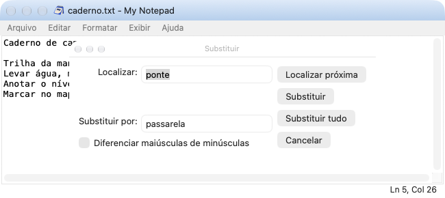

# My Notepad

**Português (Brasil)** · [English](docs/readme/en.md) · [Español](docs/readme/es.md) · [Français](docs/readme/fr.md) · [Deutsch](docs/readme/de.md) · [Italiano](docs/readme/it.md) · [日本語](docs/readme/ja.md) · [한국어](docs/readme/ko.md)

**Suíte My:** [My Explorer](https://github.com/leoars/my-explorer/blob/main/README.pt-BR.md) · **My Notepad** · [My Paint](https://github.com/leoars/my-paint)

Um editor de texto simples para macOS. Abra um .txt, escreva e salve com os atalhos que suas mãos já conhecem.

## Baixar para macOS

- **[Baixar para Apple Silicon (série M)](https://github.com/leoars/My-Notepad/releases/download/1.0.2/My-Notepad-1.0.2-arm64.pkg)**
- **[Baixar para Intel](https://github.com/leoars/My-Notepad/releases/download/1.0.2/My-Notepad-1.0.2-x86_64.pkg)**

Requer macOS 12 ou posterior. [Ver a versão mais recente](https://github.com/leoars/My-Notepad/releases/latest)


## Por que este projeto existe?

O My Notepad nasceu da falta que faz um editor de texto direto ao ponto. Para anotar um endereço ou corrigir uma linha de um arquivo antigo, bastam uma janela, cinco menus e o cursor. O projeto entrega esse jeito de trabalhar em Swift e AppKit. Cada janela edita um documento, e a fonte escolhida vale para a visualização. O arquivo continua sendo texto simples.

## Funcionalidades

### Arquivo

- **Novo**, **Abrir…**, **Salvar** e **Salvar como…**. Ao fechar, abrir ou criar um documento com alterações, o editor pergunta se deseja salvá-las.
- Abre arquivos de texto pelo Finder, mesmo com o aplicativo fechado, e oferece na primeira abertura ser o editor padrão de arquivos .txt.
- **Sair** fecha a janela; o aplicativo encerra junto.

### Edição

- **Desfazer** e **Refazer**, **Recortar**, **Copiar**, **Colar**, **Excluir** e **Selecionar tudo**.
- **Hora/data** insere a hora e a data na posição do cursor.
- Texto simples de verdade: sem corretor ortográfico, sem substituições automáticas e sem formatação escondida.

### Localizar e substituir

- **Localizar…** com direção (acima ou abaixo) e a opção de diferenciar maiúsculas de minúsculas. **Localizar próxima** repete a busca.
- **Substituir…** com **Substituir** e **Substituir tudo**. O painel abre preenchido com o texto selecionado e continua aberto enquanto você trabalha.
- **Ir para…** salta até uma linha pelo número (com a quebra automática de linha desativada).



### Formatar e exibir

- **Quebra automática de linha**, ligada ou desligada.
- **Fonte…**: família, estilo (regular, itálico, negrito, negrito itálico) e tamanho. A escolha vale para a visualização e é lembrada.
- Tamanho da fonte pelo teclado ou segurando **Ctrl** e girando a roda do mouse.
- **Barra de status** com a linha e a coluna do cursor.

### Codificações e fins de linha

- Abre e salva em ANSI (CP-1252), UTF-8, UTF-16 LE e UTF-16 BE, com detecção automática ou escolha manual ao abrir e ao salvar.
- Reconhece terminações de linha CRLF, LF e CR, e salva o arquivo com a mesma terminação.
- Se a codificação escolhida não comportar algum caractere, oferece salvar em UTF-8.

### Imprimir

- **Configurar página…**: cabeçalho, rodapé, as quatro margens, papel e orientação.
- Códigos de cabeçalho e rodapé: `&f` (nome do arquivo), `&p` (página), `&d` (data), `&t` (hora), `&l`, `&c` e `&r` (alinhamento).
- **Imprimir…** usa a fonte do editor.

### Diário em .txt

Digite `.LOG` como primeira linha de um arquivo, salve e abra-o novamente. O editor acrescenta a hora e a data ao final, com espaço para a próxima anotação. Salve a entrada para mantê-la no arquivo.

### Interface e idiomas

- Menus dentro da janela (Arquivo, Editar, Formatar, Exibir, Ajuda), além da barra de menus do macOS. **Option** com a letra do menu o abre pelo teclado.
- A posição e o tamanho da janela são lembrados.
- Disponível em português, inglês, espanhol, francês, alemão, italiano, japonês e coreano.

### Atalhos

Os atalhos com `Ctrl` funcionam como você já conhece; os de menu também aceitam `Cmd`.

| Teclas | Ação |
| --- | --- |
| `Ctrl+N` · `Ctrl+O` · `Ctrl+S` | Novo, abrir e salvar |
| `Ctrl+Shift+S` | Salvar como |
| `Ctrl+P` | Imprimir |
| `Ctrl+Z` · `Ctrl+Y` | Desfazer e refazer |
| `Ctrl+X` · `Ctrl+C` · `Ctrl+V` · `Ctrl+A` | Recortar, copiar, colar e selecionar tudo |
| `Ctrl+Insert` · `Shift+Insert` · `Shift+Delete` | Copiar, colar e recortar |
| `Ctrl+F` · `F3` | Localizar e avançar para a próxima ocorrência |
| `Ctrl+H` | Abrir Substituir |
| `Ctrl+G` | Ir para uma linha |
| `F5` | Inserir a hora e a data |
| `Ctrl+←` / `→` | Mover o cursor por palavra |
| `Ctrl+Shift+←` / `→` | Estender ou reduzir a seleção por palavra |
| `Ctrl+Backspace` · `Ctrl+Delete` | Apagar a palavra anterior ou a seguinte |
| `Home` · `End` · `Ctrl+Home` · `Ctrl+End` | Início e fim da linha ou do documento |
| `Ctrl++` / `Ctrl+-` | Aumentar ou diminuir a fonte |
| `F1` | Ajuda |

## Parte da suíte My

O My Notepad faz parte da suíte My: três aplicativos para macOS simples e diretos, com os menus e os atalhos de sempre.

- **My Notepad** (este repositório): editor de texto simples.
- **[My Explorer](https://github.com/leoars/my-explorer/blob/main/README.pt-BR.md)**: gerenciador de arquivos com árvore de pastas, abas e barra de comandos. Com o My Notepad instalado, o duplo clique em um arquivo .txt no My Explorer abre o texto aqui, e o menu de contexto ganha **Editar com o My Notepad**.
- **[My Paint](https://github.com/leoars/my-paint)**: editor de imagens simples.

## Compilar e instalar no Mac

Os instaladores têm como alvo o macOS 12 ou posterior, em Apple Silicon e Intel. Para compilar no seu Mac, use as ferramentas de desenvolvimento da Apple com o compilador Swift e Python 3. Na raiz do projeto, execute:

```sh
./build.sh
open "My Notepad.app"
```

Para rodar os testes automáticos:

```sh
./test.sh
```

Para gerar os dois instaladores, execute o comando abaixo. Em `dist/`, escolha o pacote `arm64` para Apple Silicon ou `x86_64` para Intel. Abra o arquivo `.pkg` para instalar o aplicativo em `/Applications`.

```sh
./package.sh
```

## Como contribuir

As áreas de [edição, menus e arquivos](Sources) ficam em Swift. As [traduções](Resources) estão em pastas `.lproj`, uma por idioma. Ao relatar um problema de teclado ou de acentuação, inclua a versão do macOS, o layout ou a codificação do arquivo e um exemplo curto que possamos reproduzir.

## Licença

O código e a documentação originais são distribuídos sob a [Apache License 2.0](LICENSE).
