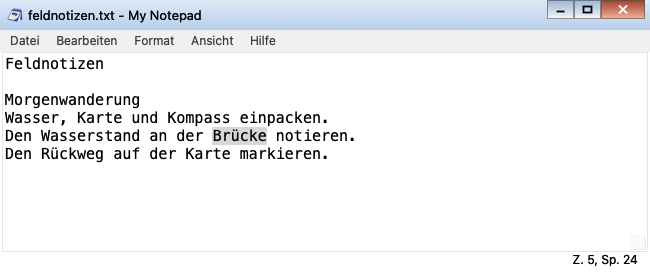
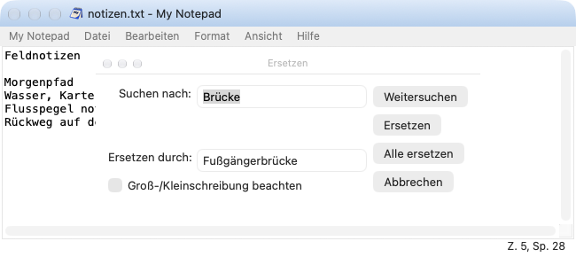

# My Notepad

[Português (Brasil)](../../README.md) · [English](en.md) · [Español](es.md) · [Français](fr.md) · **Deutsch** · [Italiano](it.md) · [日本語](ja.md) · [한국어](ko.md)

Ein Texteditor für macOS nach dem Vorbild des Editors aus Windows 7. Eine .txt-Datei öffnen, ein paar Zeilen schreiben und mit den vertrauten Tastenkürzeln speichern.

## Download für macOS

- **[Für Apple Silicon (M-Serie) herunterladen](https://github.com/leoars/My-Notepad/releases/download/1.0.1/My-Notepad-1.0.1-arm64.pkg)**
- **[Für Intel herunterladen](https://github.com/leoars/My-Notepad/releases/download/1.0.1/My-Notepad-1.0.1-x86_64.pkg)**

Erfordert macOS 12 oder neuer. [Zur neuesten Version](https://github.com/leoars/My-Notepad/releases/latest)



## Warum My Notepad?

Nach dem Umstieg von Windows auf den Mac fehlte uns das kleine Fenster, in dem man schnell eine Adresse notieren oder eine Zeile in einer alten Datei ändern konnte. My Notepad bringt dieses Stück Alltag mit Swift und AppKit auf den Mac. Jedes Fenster enthält ein Dokument und fünf Menüs. Die Schriftwahl gilt für die Anzeige im Editor. Gespeichert wird reiner Text.

## Beim Bearbeiten

- Beim Suchen und Ersetzen kann das Suchfenster offen bleiben. Schalten Sie den Zeilenumbruch aus, um mit **Bearbeiten → Gehe zu…** zu einer Zeile zu springen. Unter **Ansicht → Statusleiste** lassen sich Zeile und Spalte einblenden.
- Öffnen Sie Dateien in Windows-1252, UTF-8 oder UTF-16 (LE und BE) mit Zeilenenden von Windows, Mac oder Unix. Lässt sich ein Zeichen in der gewählten Codierung nicht darstellen, bietet der Editor an, die Datei als UTF-8 zu speichern.
- Unter **Format** wählen Sie die Schriftart. Halten Sie die **Control-Taste** gedrückt und drehen Sie das Mausrad, um die Schriftgröße zu ändern. Für den Ausdruck lassen sich Seitenränder, Kopfzeile und Fußzeile einstellen.



### Tastenkürzel

| Tasten | Funktion |
| --- | --- |
| `Ctrl+F` · `F3` | Text suchen und zum nächsten Treffer springen |
| `Ctrl+H` | Ersetzen öffnen |
| `Ctrl+G` | Zu einer Zeile springen |
| `Ctrl+Shift+←` / `→` | Die Auswahl wortweise erweitern oder verkleinern |
| `Ctrl++` / `Ctrl+-` | Schrift vergrößern oder verkleinern |
| `F5` | Uhrzeit und Datum einfügen |

### Eine Textdatei als Tagebuch

Schreiben Sie `.LOG` in die erste Zeile, speichern Sie die Datei und öffnen Sie sie erneut. Der Editor fügt am Ende Uhrzeit und Datum ein. Schreiben Sie Ihren Eintrag darunter und speichern Sie die Datei.

## Auf dem Mac bauen und installieren

Die Installationspakete sind für macOS 12 oder neuer auf Apple Silicon und Intel vorgesehen. Zum Bauen benötigen Sie die Apple-Entwicklerwerkzeuge mit Swift-Compiler sowie Python 3. Führen Sie im Projektverzeichnis diese Befehle aus.

```sh
./build.sh
open "My Notepad.app"
```

Der folgende Befehl erzeugt beide Installationspakete. Wählen Sie in `dist/` das Paket `arm64` für Apple Silicon oder `x86_64` für Intel. Öffnen Sie die `.pkg`-Datei, um die App in `/Applications` zu installieren.

```sh
./package.sh
```

## Mitwirken

[Editor, Menüs und Dateiverarbeitung](../../Sources) sind in Swift geschrieben. Die [Übersetzungen](../../Resources) liegen nach Sprache getrennt in `.lproj`-Ordnern. Geben Sie bei Tastatur- oder Codierungsfehlern die macOS-Version, das Tastaturlayout oder die Dateicodierung sowie ein kurzes reproduzierbares Beispiel an.

## Lizenz

Der ursprüngliche Quellcode und die Dokumentation stehen unter der [Apache-Lizenz 2.0](../../LICENSE).
