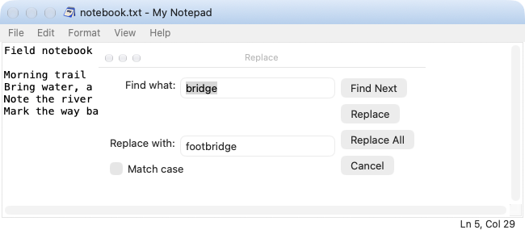

# My Notepad

[Português (Brasil)](../../README.md) · **English** · [Español](es.md) · [Français](fr.md) · [Deutsch](de.md) · [Italiano](it.md) · [日本語](ja.md) · [한국어](ko.md)

**My suite:** [My Explorer](https://github.com/leoars/my-explorer/blob/main/README.md) · **My Notepad** · [My Paint](https://github.com/leoars/my-paint/blob/main/docs/readme/en.md)

A simple text editor for macOS. Open a .txt file, write and save with the shortcuts your hands already know.

## Download for macOS

- **[Download for Apple Silicon (M-series)](https://github.com/leoars/My-Notepad/releases/download/1.0.2/My-Notepad-1.0.2-arm64.pkg)**
- **[Download for Intel](https://github.com/leoars/My-Notepad/releases/download/1.0.2/My-Notepad-1.0.2-x86_64.pkg)**

Requires macOS 12 or later. [View the latest release](https://github.com/leoars/My-Notepad/releases/latest)



## Why My Notepad?

My Notepad was born from missing a text editor that gets straight to the point. To jot down an address or fix a line in an old file, a window, five menus and the cursor are enough. The project delivers that way of working in Swift and AppKit. Each window edits one document, and the font you choose applies to the display. The file itself stays plain text.

## Features

### File

- **New**, **Open…**, **Save** and **Save As…**. When you close, open or create a document with unsaved changes, the editor asks whether you want to save them.
- Opens text files from the Finder, even when the app is not running, and offers to become the default editor for .txt files the first time you open it.
- **Exit** closes the window, and the app quits with it.

### Editing

- **Undo** and **Redo**, **Cut**, **Copy**, **Paste**, **Delete** and **Select All**.
- **Time/Date** inserts the time and date at the cursor.
- Truly plain text: no spell checker, no automatic substitutions and no hidden formatting.

### Find and replace

- **Find…** with a direction (up or down) and a match case option. **Find Next** repeats the search.
- **Replace…** with **Replace** and **Replace All**. The panel opens filled in with the selected text and stays open while you work.
- **Go To…** jumps to a line by its number (with Word Wrap turned off).


### Format and view

- **Word Wrap**, on or off.
- **Font…**: family, style (regular, italic, bold, bold italic) and size. Your choice applies to the display and is remembered.
- Change the font size from the keyboard or by holding **Ctrl** and turning the mouse wheel.
- **Status Bar** with the line and column of the cursor.

### Encodings and line endings

- Opens and saves ANSI (CP-1252), UTF-8, UTF-16 LE and UTF-16 BE, with automatic detection or a manual choice when opening and saving.
- Recognises CRLF, LF and CR line endings, and saves the file with the same one.
- If your chosen encoding cannot represent a character, the editor offers to save as UTF-8.

### Printing

- **Page Setup…**: header, footer, all four margins, paper and orientation.
- Header and footer codes: `&f` (file name), `&p` (page), `&d` (date), `&t` (time), `&l`, `&c` and `&r` (alignment).
- **Print…** uses the editor font.

### A logbook in a .txt file

Type `.LOG` on the first line of a file, save it and reopen it. My Notepad appends the time and date at the end, ready for your next entry. Save the entry to keep it in the file.

### Interface and languages

- Menus inside the window (File, Edit, Format, View, Help), in addition to the macOS menu bar. **Option** plus a menu’s letter opens it from the keyboard.
- The window position and size are remembered.
- Available in Portuguese, English, Spanish, French, German, Italian, Japanese and Korean.

### Keyboard shortcuts

The `Ctrl` shortcuts work the way you already know; the menu shortcuts also accept `Cmd`.

| Keys | Action |
| --- | --- |
| `Ctrl+N` · `Ctrl+O` · `Ctrl+S` | New, open and save |
| `Ctrl+Shift+S` | Save as |
| `Ctrl+P` | Print |
| `Ctrl+Z` · `Ctrl+Y` | Undo and redo |
| `Ctrl+X` · `Ctrl+C` · `Ctrl+V` · `Ctrl+A` | Cut, copy, paste and select all |
| `Ctrl+Insert` · `Shift+Insert` · `Shift+Delete` | Copy, paste and cut |
| `Ctrl+F` · `F3` | Find text and advance to the next match |
| `Ctrl+H` | Open Replace |
| `Ctrl+G` | Go to a line |
| `F5` | Insert the time and date |
| `Ctrl+←` / `→` | Move the cursor by one word |
| `Ctrl+Shift+←` / `→` | Extend or shrink the selection by one word |
| `Ctrl+Backspace` · `Ctrl+Delete` | Delete the previous or the next word |
| `Home` · `End` · `Ctrl+Home` · `Ctrl+End` | Start and end of the line or of the document |
| `Ctrl++` / `Ctrl+-` | Increase or decrease font size |
| `F1` | Help |

## Part of the My suite

My Notepad is part of the My suite: three simple, straightforward apps for macOS, with the menus and shortcuts you already know.

- **My Notepad** (this repository): a simple text editor.
- **[My Explorer](https://github.com/leoars/my-explorer/blob/main/README.md)**: a file manager with a folder tree, tabs and a command bar. With My Notepad installed, double-clicking a .txt file in My Explorer opens it here, and the context menu gains **Edit with My Notepad**.
- **[My Paint](https://github.com/leoars/my-paint/blob/main/docs/readme/en.md)**: a simple image editor.

## Build and install on Mac

The installers target macOS 12 or later on Apple Silicon and Intel. To build locally, you need Apple’s developer tools with the Swift compiler and Python 3. From the project root, run:

```sh
./build.sh
open "My Notepad.app"
```

To run the automated tests:

```sh
./test.sh
```

To build both installers, run the command below. In `dist/`, choose the `arm64` package for Apple Silicon or `x86_64` for Intel. Open the `.pkg` to install the app in `/Applications`.

```sh
./package.sh
```

## Contributing

The [editor, menus and file handling](../../Sources) are written in Swift. The [translations](../../Resources) live in one `.lproj` directory per language. For keyboard or encoding issues, include your macOS version, keyboard layout or file encoding, and a short example we can reproduce.

## License

Original code and documentation are distributed under the [Apache License 2.0](../../LICENSE).
