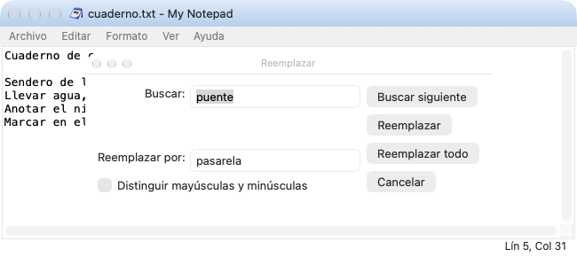
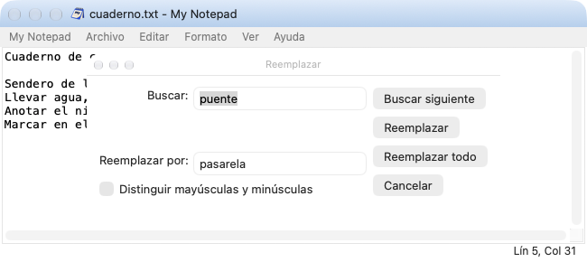

# My Notepad

[Português (Brasil)](../../README.md) · [English](en.md) · **Español** · [Français](fr.md) · [Deutsch](de.md) · [Italiano](it.md) · [日本語](ja.md) · [한국어](ko.md)

Un editor de texto plano para macOS inspirado en el Bloc de notas de Windows 7. Abre un archivo .txt, escribe unas líneas y guárdalas con los atajos de siempre.

## Descargar para macOS

- **[Descargar para Apple Silicon (serie M)](https://github.com/leoars/My-Notepad/releases/download/1.0.1/My-Notepad-1.0.1-arm64.pkg)**
- **[Descargar para Intel](https://github.com/leoars/My-Notepad/releases/download/1.0.1/My-Notepad-1.0.1-x86_64.pkg)**

Requiere macOS 12 o posterior. [Ver la última versión](https://github.com/leoars/My-Notepad/releases/latest)



## Por qué existe My Notepad

Al pasar de Windows al Mac, echábamos de menos esa pequeña ventana que bastaba para apuntar una dirección o corregir una línea de un archivo antiguo. My Notepad recupera esa experiencia con Swift y AppKit. Cada ventana contiene un documento y cinco menús. La fuente es una preferencia del editor y el archivo se guarda como texto plano.

## Edición cotidiana

- Busca y reemplaza texto con el panel de búsqueda abierto. Desactiva el ajuste de línea para ir directamente a una línea desde **Editar → Ir a…** o activa **Ver → Barra de estado** para consultar la línea y la columna.
- Abre archivos Windows-1252, UTF-8 y UTF-16 (LE o BE) con finales de línea de Windows, Mac o Unix. Si un carácter no cabe en la codificación elegida, el editor ofrece guardar en UTF-8.
- Elige la fuente en **Formato** o mantén pulsada **Ctrl** y gira la rueda del ratón para ajustar el tamaño. Al imprimir puedes definir los márgenes, el encabezado y el pie de página.



### Atajos de teclado

| Teclas | Acción |
| --- | --- |
| `Ctrl+F` · `F3` | Buscar y pasar a la siguiente coincidencia |
| `Ctrl+H` | Abrir Reemplazar |
| `Ctrl+G` | Ir a una línea |
| `Ctrl+Shift+←` / `→` | Ampliar o reducir la selección por palabras |
| `Ctrl++` / `Ctrl+-` | Aumentar o reducir el tamaño de la fuente |
| `F5` | Insertar la hora y la fecha |

### Un diario en texto plano

Escribe `.LOG` en la primera línea, guarda el archivo y vuelve a abrirlo. El editor añade la hora y la fecha al final para que escribas la siguiente entrada. Guarda los cambios para conservarla.

## Compilar e instalar en el Mac

Los instaladores son para macOS 12 o posterior, tanto en Apple Silicon como en Intel. Para compilar, necesitas las herramientas de desarrollo de Apple con el compilador Swift y Python 3. Desde la raíz del proyecto, ejecuta:

```sh
./build.sh
open "My Notepad.app"
```

Para generar ambos instaladores, ejecuta el siguiente comando. En `dist/`, elige el paquete `arm64` para Apple Silicon o `x86_64` para Intel. Abre el `.pkg` para instalar la aplicación en `/Applications`.

```sh
./package.sh
```

## Cómo contribuir

El [editor, los menús y la gestión de archivos](../../Sources) están escritos en Swift. Las [traducciones](../../Resources) se organizan en carpetas `.lproj` por idioma. Si detectas un problema con el teclado o los caracteres, indica la versión de macOS, la distribución del teclado o la codificación y un ejemplo que permita reproducirlo.

## Licencia

El código y la documentación originales se distribuyen bajo la [licencia Apache 2.0](../../LICENSE).
