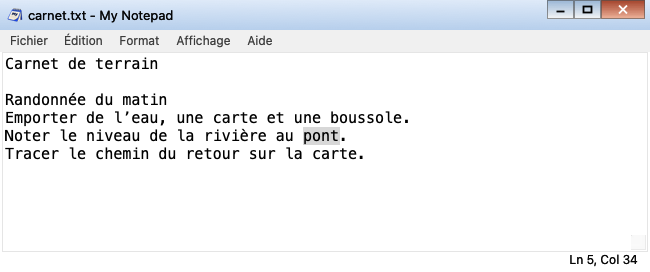
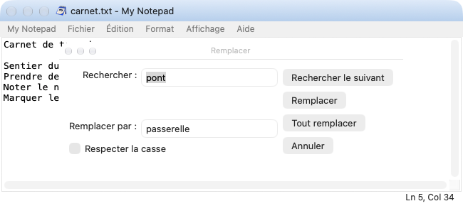

# My Notepad

[Português (Brasil)](../../README.md) · [English](en.md) · [Español](es.md) · **Français** · [Deutsch](de.md) · [Italiano](it.md) · [日本語](ja.md) · [한국어](ko.md)

**Suite My:** [My Explorer](https://github.com/leoars/my-explorer/blob/main/README.fr.md) · **My Notepad** · [My Paint](https://github.com/leoars/my-paint/blob/main/docs/readme/fr.md)

Un éditeur de texte simple pour macOS. Ouvrez un .txt, écrivez et enregistrez avec les raccourcis que vos mains connaissent déjà.

## Télécharger pour macOS

- **[Télécharger pour Apple Silicon (série M)](https://github.com/leoars/My-Notepad/releases/download/1.0.5/My-Notepad-1.0.5-arm64.pkg)**
- **[Télécharger pour Intel](https://github.com/leoars/My-Notepad/releases/download/1.0.5/My-Notepad-1.0.5-x86_64.pkg)**

Nécessite macOS 12 ou une version ultérieure. [Voir la dernière version](https://github.com/leoars/My-Notepad/releases/latest)

Pour installer My Explorer, My Notepad et My Paint en une seule fois, utilisez le [programme d’installation de la suite My](https://github.com/leoars/my-suite/blob/main/docs/readme/en.md).



## Pourquoi My Notepad ?

My Notepad est né du manque d’un éditeur de texte qui va droit au but. Pour noter une adresse ou corriger une ligne dans un vieux fichier, une fenêtre, cinq menus et le curseur suffisent. Le projet propose cette façon de travailler en Swift et AppKit. Chaque fenêtre édite un document, et la police choisie s’applique à l’affichage. Le fichier reste en texte brut.

## Fonctionnalités

### Fichier

- **Nouveau**, **Ouvrir…**, **Enregistrer** et **Enregistrer sous…**. Lorsque vous fermez, ouvrez ou créez un document alors que des modifications sont en attente, l’éditeur vous demande si vous souhaitez les enregistrer.
- Ouvre les fichiers texte depuis le Finder, même lorsque l’application est fermée, et propose à la première ouverture de devenir l’éditeur par défaut des fichiers .txt.
- **Nouvelle fenêtre** ouvre un autre document à côté. Un fichier ouvert depuis le Finder ou depuis My Explorer obtient sa propre fenêtre, sans retirer de l’écran le document déjà ouvert ; s’il est déjà ouvert, sa fenêtre passe au premier plan.
- **Quitter** ferme la fenêtre ; l’application se ferme avec la dernière fenêtre.
- **Réglages…** (`Cmd+,`) propose **Reprendre la session précédente** : fermer la fenêtre, quitter l’application ou redémarrer le Mac ne demande plus d’enregistrer, et ce qui n’a pas été enregistré est conservé sur ce Mac et revient à la prochaine ouverture, chaque document dans sa fenêtre. L’option est activée par défaut ; pour que la question revienne, choisissez **Commencer une nouvelle session**.
- **Rechercher les mises à jour…** dans le menu My Notepad, et une vérification à l’ouverture, au plus une fois par jour, que vous pouvez désactiver dans **Réglages…**. La nouvelle version n’est téléchargée qu’avec votre accord, elle est vérifiée (signature du développeur et notarisation d’Apple) et s’ouvre dans le programme d’installation de macOS ; My Notepad se rouvre à la fin de l’installation.

### Édition

- **Annuler** et **Rétablir**, **Couper**, **Copier**, **Coller**, **Supprimer** et **Tout sélectionner**.
- **Heure/Date** insère l’heure et la date à la position du curseur.
- Du vrai texte brut : pas de correcteur orthographique, pas de substitutions automatiques, pas de mise en forme cachée.

### Rechercher et remplacer

- **Rechercher…** avec le choix de la direction (vers le haut ou vers le bas) et l’option permettant de respecter la casse. **Rechercher le suivant** relance la recherche.
- **Remplacer…** avec **Remplacer** et **Tout remplacer**. La fenêtre s’ouvre avec le texte sélectionné déjà saisi et reste ouverte pendant que vous travaillez.
- **Atteindre…** vous amène à une ligne d’après son numéro (lorsque le retour automatique à la ligne est désactivé).



### Format et affichage

- **Retour automatique à la ligne**, activé ou désactivé.
- **Police…** : famille, style (normal, italique, gras, gras italique) et taille. Ce choix s’applique à l’affichage et il est mémorisé.
- Taille de la police au clavier, ou en maintenant **Ctrl** et en tournant la molette de la souris.
- **Barre d’état** indiquant la ligne et la colonne du curseur.

### Encodages et fins de ligne

- Ouvre et enregistre en ANSI (CP-1252), UTF-8, UTF-16 LE et UTF-16 BE, avec détection automatique ou choix manuel à l’ouverture comme à l’enregistrement.
- Reconnaît les fins de ligne CRLF, LF et CR, et enregistre le fichier avec la même fin de ligne.
- Si l’encodage choisi ne peut pas représenter un caractère, l’éditeur propose d’enregistrer en UTF-8.

### Imprimer

- **Mise en page…** : en-tête, pied de page, les quatre marges, papier et orientation.
- Codes d’en-tête et de pied de page : `&f` (nom du fichier), `&p` (page), `&d` (date), `&t` (heure), `&l`, `&c` et `&r` (alignement).
- **Imprimer…** utilise la police de l’éditeur.

### Un journal en .txt

Saisissez `.LOG` sur la première ligne d’un fichier, enregistrez-le et ouvrez-le de nouveau. L’éditeur ajoute l’heure et la date à la fin pour accueillir la prochaine entrée. Enregistrez-la pour la conserver.

### Interface et langues

- Des menus dans la fenêtre (My Notepad, Fichier, Édition, Format, Affichage, Aide), en plus de la barre des menus de macOS. **Option** avec la lettre du menu l’ouvre au clavier.
- La position et la taille de la fenêtre sont mémorisées.
- Disponible en portugais, anglais, espagnol, français, allemand, italien, japonais et coréen.

### Raccourcis clavier

Les raccourcis avec `Ctrl` fonctionnent comme vous les connaissez déjà ; ceux des menus acceptent aussi `Cmd`.

| Touches | Action |
| --- | --- |
| `Ctrl+N` · `Ctrl+O` · `Ctrl+S` | Nouveau, ouvrir et enregistrer |
| `Ctrl+Shift+S` | Enregistrer sous |
| `Ctrl+Shift+N` | Nouvelle fenêtre |
| `Ctrl+P` | Imprimer |
| `Ctrl+Z` · `Ctrl+Y` | Annuler et rétablir |
| `Ctrl+X` · `Ctrl+C` · `Ctrl+V` · `Ctrl+A` | Couper, copier, coller et tout sélectionner |
| `Ctrl+Insert` · `Shift+Insert` · `Shift+Delete` | Copier, coller et couper |
| `Ctrl+F` · `F3` | Rechercher puis passer à l’occurrence suivante |
| `Ctrl+H` | Ouvrir la fenêtre Remplacer |
| `Ctrl+G` | Atteindre une ligne |
| `F5` | Insérer l’heure et la date |
| `Ctrl+←` / `→` | Déplacer le curseur mot par mot |
| `Ctrl+Shift+←` / `→` | Étendre ou réduire la sélection mot par mot |
| `Ctrl+Backspace` · `Ctrl+Delete` | Effacer le mot précédent ou le mot suivant |
| `Home` · `End` · `Ctrl+Home` · `Ctrl+End` | Début et fin de la ligne ou du document |
| `Ctrl++` / `Ctrl+-` | Agrandir ou réduire la police |
| `F1` | Aide |

## Un élément de la suite My

My Notepad fait partie de la suite My : trois applications pour macOS simples et directes, avec les menus et les raccourcis de toujours.

- **My Notepad** (ce dépôt) : éditeur de texte simple.
- **[My Explorer](https://github.com/leoars/my-explorer/blob/main/README.fr.md)** : gestionnaire de fichiers avec arborescence des dossiers, onglets et barre de commandes. Lorsque My Notepad est installé, un double-clic sur un fichier .txt dans My Explorer ouvre le texte ici, et le menu contextuel s’enrichit de **Modifier avec My Notepad**.
- **[My Paint](https://github.com/leoars/my-paint/blob/main/docs/readme/fr.md)** : éditeur d’images simple.

## Compiler et installer sur Mac

Les paquets ciblent macOS 12 ou ultérieur sur Apple Silicon et Intel. La compilation nécessite les outils de développement Apple avec le compilateur Swift et Python 3. À la racine du projet, exécutez les commandes suivantes.

```sh
./build.sh
open "My Notepad.app"
```

Pour lancer les tests automatiques :

```sh
./test.sh
```

Pour créer les deux paquets d’installation, exécutez la commande ci-dessous. Dans `dist/`, choisissez `arm64` pour Apple Silicon ou `x86_64` pour Intel. Ouvrez le fichier `.pkg` pour installer l’application dans `/Applications`.

```sh
./package.sh
```

## Contribuer

[L’éditeur, les menus et la gestion des fichiers](../../Sources) sont écrits en Swift. Les [traductions](../../Resources) disposent chacune d’un dossier `.lproj`. Pour signaler un problème de clavier ou d’encodage, précisez la version de macOS, la disposition du clavier ou l’encodage du fichier et donnez un court exemple reproductible.

## Licence

Le code et la documentation d’origine sont distribués sous [licence Apache 2.0](../../LICENSE).
