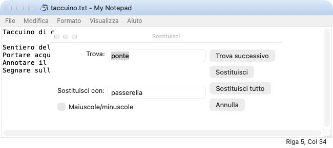
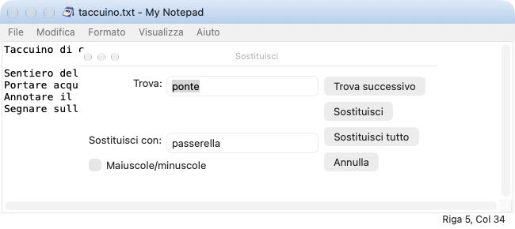

# My Notepad

[Português (Brasil)](../../README.md) · [English](en.md) · [Español](es.md) · [Français](fr.md) · [Deutsch](de.md) · **Italiano** · [日本語](ja.md) · [한국어](ko.md)

**Suite My:** [My Explorer](https://github.com/leoars/my-explorer/blob/main/README.it.md) · **My Notepad** · [My Paint](https://github.com/leoars/my-paint/blob/main/docs/readme/it.md)

Un editor di testo semplice per macOS. Apri un .txt, scrivi e salva con le scorciatoie che le tue mani conoscono già.

## Scarica per macOS

- **[Scarica per Apple Silicon (serie M)](https://github.com/leoars/My-Notepad/releases/download/1.0.2/My-Notepad-1.0.2-arm64.pkg)**
- **[Scarica per Intel](https://github.com/leoars/My-Notepad/releases/download/1.0.2/My-Notepad-1.0.2-x86_64.pkg)**

Richiede macOS 12 o successivo. [Vedi la versione più recente](https://github.com/leoars/My-Notepad/releases/latest)



## Perché My Notepad?

My Notepad è nato dalla mancanza di un editor di testo che vada dritto al punto. Per annotare un indirizzo o correggere una riga di un vecchio file bastano una finestra, cinque menu e il cursore. Il progetto offre questo modo di lavorare in Swift e AppKit. Ogni finestra modifica un documento, e il carattere scelto vale per la visualizzazione. Il file rimane testo semplice.

## Funzionalità

### File

- **Nuovo**, **Apri…**, **Salva** e **Salva con nome…**. Quando chiudi, apri o crei un documento con modifiche non salvate, l’editor chiede se vuoi salvarle.
- Apre i file di testo dal Finder, anche con l’app chiusa, e alla prima apertura propone di diventare l’editor predefinito dei file .txt.
- **Esci** chiude la finestra e, con essa, l’app.

### Modifica

- **Annulla** e **Ripristina**, **Taglia**, **Copia**, **Incolla**, **Elimina** e **Seleziona tutto**.
- **Ora/data** inserisce l’ora e la data nella posizione del cursore.
- Testo semplice per davvero: niente correttore ortografico, niente sostituzioni automatiche e niente formattazione nascosta.

### Trova e sostituisci

- **Trova…** con la direzione (su o giù) e l’opzione per distinguere maiuscole e minuscole. **Trova successivo** ripete la ricerca.
- **Sostituisci…** con **Sostituisci** e **Sostituisci tutto**. La finestra si apre già compilata con il testo selezionato e resta aperta mentre lavori.
- **Vai a…** salta a una riga indicandone il numero (con l’a capo automatico disattivato).



### Formato e visualizzazione

- **A capo automatico**, attivato o disattivato.
- **Carattere…**: famiglia, stile (normale, corsivo, grassetto, grassetto corsivo) e dimensione. La scelta vale per la visualizzazione e viene ricordata.
- Dimensione del carattere dalla tastiera oppure tenendo premuto **Ctrl** e girando la rotellina del mouse.
- **Barra di stato** con la riga e la colonna del cursore.

### Codifiche e terminazioni di riga

- Apre e salva in ANSI (CP-1252), UTF-8, UTF-16 LE e UTF-16 BE, con rilevamento automatico o scelta manuale all’apertura e al salvataggio.
- Riconosce le terminazioni di riga CRLF, LF e CR, e salva il file con la stessa terminazione.
- Se la codifica scelta non supporta un carattere, l’editor propone di salvare in UTF-8.

### Stampa

- **Imposta pagina…**: intestazione, piè di pagina, i quattro margini, carta e orientamento.
- Codici di intestazione e piè di pagina: `&f` (nome del file), `&p` (pagina), `&d` (data), `&t` (ora), `&l`, `&c` e `&r` (allineamento).
- **Stampa…** usa il carattere dell’editor.

### Un diario in .txt

Scrivi `.LOG` sulla prima riga di un file, salvalo e riaprilo. L’editor aggiunge ora e data in fondo al documento. Scrivi la nuova annotazione e salva per conservarla.

### Interfaccia e lingue

- Menu all’interno della finestra (File, Modifica, Formato, Visualizza, Aiuto), oltre alla barra dei menu di macOS. **Option** con la lettera del menu lo apre dalla tastiera.
- La posizione e la dimensione della finestra vengono ricordate.
- Disponibile in portoghese, inglese, spagnolo, francese, tedesco, italiano, giapponese e coreano.

### Scorciatoie da tastiera

Le scorciatoie con `Ctrl` funzionano come le conosci già; quelle dei menu accettano anche `Cmd`.

| Tasti | Azione |
| --- | --- |
| `Ctrl+N` · `Ctrl+O` · `Ctrl+S` | Nuovo, aprire e salvare |
| `Ctrl+Shift+S` | Salvare con nome |
| `Ctrl+P` | Stampare |
| `Ctrl+Z` · `Ctrl+Y` | Annullare e ripristinare |
| `Ctrl+X` · `Ctrl+C` · `Ctrl+V` · `Ctrl+A` | Tagliare, copiare, incollare e selezionare tutto |
| `Ctrl+Insert` · `Shift+Insert` · `Shift+Delete` | Copiare, incollare e tagliare |
| `Ctrl+F` · `F3` | Cercare e passare all’occorrenza successiva |
| `Ctrl+H` | Aprire Sostituisci |
| `Ctrl+G` | Andare a una riga |
| `F5` | Inserire ora e data |
| `Ctrl+←` / `→` | Spostare il cursore di una parola |
| `Ctrl+Shift+←` / `→` | Estendere o ridurre la selezione di una parola |
| `Ctrl+Backspace` · `Ctrl+Delete` | Cancellare la parola precedente o quella successiva |
| `Home` · `End` · `Ctrl+Home` · `Ctrl+End` | Inizio e fine della riga o del documento |
| `Ctrl++` / `Ctrl+-` | Aumentare o ridurre il carattere |
| `F1` | Aiuto |

## Parte della suite My

My Notepad fa parte della suite My: tre app per macOS semplici e dirette, con i menu e le scorciatoie di sempre.

- **My Notepad** (questo repository): editor di testo semplice.
- **[My Explorer](https://github.com/leoars/my-explorer/blob/main/README.it.md)**: gestore di file con albero delle cartelle, schede e barra dei comandi. Con My Notepad installato, il doppio clic su un file .txt in My Explorer apre il testo qui, e nel menu contestuale compare **Modifica con My Notepad**.
- **[My Paint](https://github.com/leoars/my-paint/blob/main/docs/readme/it.md)**: editor di immagini semplice.

## Compilazione e installazione sul Mac

I pacchetti richiedono macOS 12 o successivo e sono disponibili per Apple Silicon e Intel. Per compilare servono gli strumenti di sviluppo Apple con il compilatore Swift e Python 3. Dalla radice del progetto esegui questi comandi.

```sh
./build.sh
open "My Notepad.app"
```

Per eseguire i test automatici:

```sh
./test.sh
```

Il comando seguente genera entrambi i pacchetti. In `dist/` scegli `arm64` per Apple Silicon oppure `x86_64` per Intel. Apri il file `.pkg` per installare l’app in `/Applications`.

```sh
./package.sh
```

## Come contribuire

[L’editor, i menu e la gestione dei file](../../Sources) sono scritti in Swift. Le [traduzioni](../../Resources) si trovano in una cartella `.lproj` per ogni lingua. Per segnalare un problema di tastiera o codifica, indica la versione di macOS, il layout della tastiera o la codifica del file e un breve esempio riproducibile.

## Licenza

Il codice e la documentazione originali sono distribuiti con [licenza Apache 2.0](../../LICENSE).
