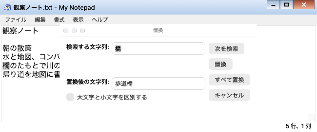

# My Notepad

[Português (Brasil)](../../README.md) · [English](en.md) · [Español](es.md) · [Français](fr.md) · [Deutsch](de.md) · [Italiano](it.md) · **日本語** · [한국어](ko.md)

Windows 7 の「メモ帳」を手本にした、macOS 用のプレーンテキストエディタです。.txt ファイルを開き、数行書いて、使い慣れたショートカットで保存できます。



## 開発のきっかけ

Windows から Mac に移ったとき、住所をひとつ控えたり、古いファイルを一行だけ直したりするための、あの小さなウインドウが恋しくなりました。My Notepad は、その使い心地を Swift と AppKit で再現するプロジェクトです。ひとつのウインドウにひとつの文書と五つのメニュー。フォントはエディタの表示設定として記憶され、ファイルにはテキストだけが保存されます。

## 編集のポイント

- 検索パネルを開いたまま、本文の検索や置換ができます。折り返しをオフにすると、**編集 → 指定行へ移動…** で目的の行に移動できます。**表示 → ステータス バー** をオンにすると、行と列を確認できます。
- Windows-1252、UTF-8、UTF-16（LE・BE）のファイルを開けます。Windows、Mac、Unix の改行形式に対応しています。選んだ文字コードで表せない文字があるときは、UTF-8 での保存を選べます。
- **書式** メニューでフォントを設定できます。**Ctrl** を押しながらマウスホイールを回すと文字サイズが変わります。印刷時には余白、ヘッダー、フッターを指定できます。


### キーボードショートカット

| キー | 操作 |
| --- | --- |
| `Ctrl+F` · `F3` | 検索する・次の一致箇所に移動する |
| `Ctrl+H` | 置換パネルを開く |
| `Ctrl+G` | 指定した行に移動する |
| `Ctrl+Shift+←` / `→` | 単語単位で選択範囲を広げる・縮める |
| `Ctrl++` / `Ctrl+-` | 文字を大きくする・小さくする |
| `F5` | 現在の時刻と日付を挿入する |

### テキストファイルで作業日誌をつける

ファイルの先頭行に `.LOG` と入力して保存し、開き直してみてください。末尾に現在の時刻と日付が追加されます。続きに記録を書き、保存すれば、その日の作業日誌になります。

## Mac でのビルドとインストール

インストーラの対象は macOS 12 以降の Apple Silicon Mac と Intel Mac です。ビルドには Swift コンパイラを含む Apple の開発ツールと Python 3 が必要です。プロジェクトのルートで次のコマンドを実行します。

```sh
./build.sh
open "My Notepad.app"
```

次のコマンドで両方のインストーラを作成できます。`dist/` から Apple Silicon 向けの `arm64`、または Intel 向けの `x86_64` パッケージを選んでください。`.pkg` を開くと、アプリを `/Applications` にインストールできます。

```sh
./package.sh
```

## 開発への参加

[エディタ、メニュー、ファイルの読み書き](../../Sources) は Swift で実装しています。[翻訳](../../Resources) は言語ごとの `.lproj` フォルダにあります。キー操作や文字化けについて報告する際は、macOS のバージョン、キーボード配列または文字コード、再現できる短い例を添えてください。

## ライセンス

本プロジェクト独自のコードと文書には [Apache License 2.0](../../LICENSE) が適用されます。
