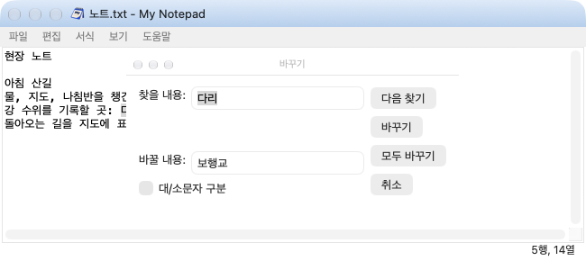
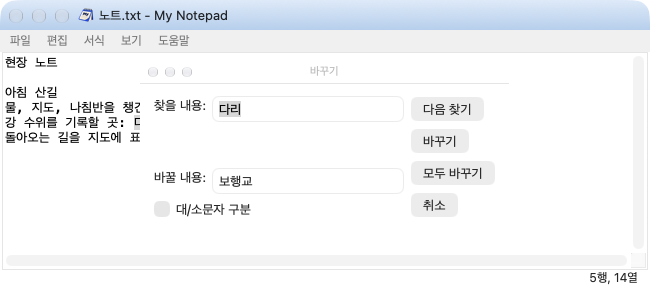

# My Notepad

[Português (Brasil)](../../README.md) · [English](en.md) · [Español](es.md) · [Français](fr.md) · [Deutsch](de.md) · [Italiano](it.md) · [日本語](ja.md) · **한국어**

**My 스위트:** [My Explorer](https://github.com/leoars/my-explorer/blob/main/README.ko.md) · **My Notepad** · [My Paint](https://github.com/leoars/my-paint/blob/main/docs/readme/ko.md)

macOS용 간단한 텍스트 편집기입니다. .txt 파일을 열고, 쓰고, 손에 익은 단축키로 저장하세요.

## macOS용 다운로드

- **[Apple Silicon(M 시리즈)용 다운로드](https://github.com/leoars/My-Notepad/releases/download/1.0.2/My-Notepad-1.0.2-arm64.pkg)**
- **[Intel용 다운로드](https://github.com/leoars/My-Notepad/releases/download/1.0.2/My-Notepad-1.0.2-x86_64.pkg)**

macOS 12 이상이 필요합니다. [최신 릴리스 보기](https://github.com/leoars/My-Notepad/releases/latest)



## 만든 이유

My Notepad는 군더더기 없는 텍스트 편집기가 아쉬워서 시작한 프로젝트입니다. 주소를 적거나 오래된 파일의 한 줄을 고치는 데는 창 하나, 메뉴 다섯 개, 커서면 충분합니다. 이 프로젝트는 그 작업 방식을 Swift와 AppKit으로 구현합니다. 창 하나에서 문서 하나를 편집하며, 선택한 글꼴은 화면 표시에만 적용됩니다. 파일은 일반 텍스트 그대로입니다.

## 기능

### 파일

- **새로 만들기**, **열기…**, **저장**, **다른 이름으로 저장…**. 변경 내용이 있는 문서를 닫거나 다른 문서를 열거나 새로 만들 때는 변경 내용을 저장할지 묻습니다.
- 앱이 실행 중이 아니어도 Finder에서 텍스트 파일을 열 수 있으며, 처음 실행할 때 .txt 파일의 기본 편집기로 사용할지 묻습니다.
- **끝내기** 를 선택하면 창이 닫히고 앱도 함께 종료됩니다.

### 편집

- **실행 취소** 와 **다시 실행**, **잘라내기**, **복사**, **붙여넣기**, **삭제**, **모두 선택**.
- **시간/날짜** 는 커서 위치에 현재 시간과 날짜를 삽입합니다.
- 진짜 일반 텍스트입니다. 맞춤법 검사도, 자동 대치도, 숨은 서식도 없습니다.

### 찾기 및 바꾸기

- **찾기…** 에서는 방향(위로 또는 아래로)과 대/소문자 구분 여부를 지정할 수 있습니다. **다음 찾기** 로 같은 검색을 반복합니다.
- **바꾸기…** 에서는 **바꾸기** 와 **모두 바꾸기** 를 사용할 수 있습니다. 창은 선택한 텍스트가 입력된 상태로 열리고, 작업하는 동안 계속 열려 있습니다.
- **이동…** 은 줄 번호를 입력해 해당 줄로 바로 갑니다(자동 줄 바꿈이 꺼져 있을 때).



### 서식 및 보기

- **자동 줄 바꿈** 켜기 또는 끄기.
- **글꼴…**: 글꼴, 스타일(보통, 기울임꼴, 굵게, 굵은 기울임꼴), 크기. 선택한 글꼴은 화면 표시에 적용되며 다음에도 기억됩니다.
- 글자 크기는 키보드로 조절하거나 **Ctrl** 키를 누른 채 마우스 휠을 돌려 조절합니다.
- **상태 표시줄** 에 커서의 줄과 열이 표시됩니다.

### 인코딩과 줄바꿈 형식

- ANSI(CP-1252), UTF-8, UTF-16 LE, UTF-16 BE로 열고 저장합니다. 열 때와 저장할 때 자동 감지에 맡기거나 직접 선택할 수 있습니다.
- CRLF, LF, CR 줄바꿈 형식을 인식하고, 같은 형식으로 파일을 저장합니다.
- 선택한 인코딩으로 표현할 수 없는 문자가 있으면 UTF-8로 저장할 수 있습니다.

### 인쇄

- **페이지 설정…**: 머리글, 바닥글, 네 방향의 여백, 용지 및 방향.
- 머리글 및 바닥글 코드: `&f`(파일 이름), `&p`(페이지), `&d`(날짜), `&t`(시간), `&l`, `&c`, `&r`(맞춤).
- **인쇄…** 는 편집기의 글꼴을 사용합니다.

### .txt로 쓰는 작업 일지

파일 첫 줄에 `.LOG`를 입력한 다음 저장하고 다시 열어 보세요. 파일 끝에 현재 시간과 날짜가 추가됩니다. 이어서 기록을 작성한 뒤 저장하면 일지에 남습니다.

### 인터페이스와 언어

- macOS 메뉴 막대와 별도로 창 안에도 메뉴(파일, 편집, 서식, 보기, 도움말)가 있습니다. **Option** 키와 메뉴의 글자 키를 함께 누르면 키보드로 메뉴를 열 수 있습니다.
- 창의 위치와 크기를 기억합니다.
- 포르투갈어, 영어, 스페인어, 프랑스어, 독일어, 이탈리아어, 일본어, 한국어를 지원합니다.

### 키보드 단축키

`Ctrl` 단축키는 익숙한 그대로 동작하며, 메뉴 단축키는 `Cmd` 로도 사용할 수 있습니다.

| 키 | 동작 |
| --- | --- |
| `Ctrl+N` · `Ctrl+O` · `Ctrl+S` | 새로 만들기, 열기, 저장 |
| `Ctrl+Shift+S` | 다른 이름으로 저장 |
| `Ctrl+P` | 인쇄 |
| `Ctrl+Z` · `Ctrl+Y` | 실행 취소 및 다시 실행 |
| `Ctrl+X` · `Ctrl+C` · `Ctrl+V` · `Ctrl+A` | 잘라내기, 복사, 붙여넣기, 모두 선택 |
| `Ctrl+Insert` · `Shift+Insert` · `Shift+Delete` | 복사, 붙여넣기, 잘라내기 |
| `Ctrl+F` · `F3` | 텍스트 찾기 및 다음 항목으로 이동 |
| `Ctrl+H` | 바꾸기 창 열기 |
| `Ctrl+G` | 원하는 줄로 이동 |
| `F5` | 현재 시간과 날짜 삽입 |
| `Ctrl+←` / `→` | 단어 단위로 커서 이동 |
| `Ctrl+Shift+←` / `→` | 단어 단위로 선택 영역 늘리기 또는 줄이기 |
| `Ctrl+Backspace` · `Ctrl+Delete` | 이전 단어 또는 다음 단어 지우기 |
| `Home` · `End` · `Ctrl+Home` · `Ctrl+End` | 줄 또는 문서의 처음과 끝으로 이동 |
| `Ctrl++` / `Ctrl+-` | 글자 크기 키우기 또는 줄이기 |
| `F1` | 도움말 |

## My 스위트의 일부

My Notepad는 My 스위트에 속한 앱입니다. My 스위트는 익숙한 메뉴와 단축키를 갖춘, 간단하고 직관적인 세 가지 macOS 앱으로 이루어져 있습니다.

- **My Notepad**(이 저장소): 간단한 텍스트 편집기.
- **[My Explorer](https://github.com/leoars/my-explorer/blob/main/README.ko.md)**: 폴더 트리, 탭, 명령 모음을 갖춘 파일 관리자. My Notepad가 설치되어 있으면 My Explorer에서 .txt 파일을 두 번 클릭할 때 이 편집기에서 열리고, 컨텍스트 메뉴에 **My Notepad로 편집** 이 추가됩니다.
- **[My Paint](https://github.com/leoars/my-paint/blob/main/docs/readme/ko.md)**: 간단한 이미지 편집기.

## Mac에서 빌드 및 설치

설치 패키지는 macOS 12 이상을 실행하는 Apple Silicon 및 Intel Mac용입니다. 직접 빌드하려면 Swift 컴파일러가 포함된 Apple 개발 도구와 Python 3가 필요합니다. 프로젝트 루트에서 다음 명령을 실행하세요.

```sh
./build.sh
open "My Notepad.app"
```

자동 테스트를 실행하려면:

```sh
./test.sh
```

아래 명령으로 두 아키텍처용 설치 패키지를 모두 만듭니다. `dist/`에서 Apple Silicon용 `arm64` 또는 Intel용 `x86_64` 패키지를 선택하세요. `.pkg` 파일을 열면 앱을 `/Applications`에 설치할 수 있습니다.

```sh
./package.sh
```

## 기여하기

[편집기, 메뉴, 파일 입출력](../../Sources)은 Swift로 구현했습니다. [번역 파일](../../Resources)은 언어별 `.lproj` 폴더에 있습니다. 키보드나 인코딩 문제를 제보할 때는 macOS 버전, 키보드 배열 또는 파일 인코딩, 문제를 재현할 수 있는 짧은 예를 함께 알려 주세요.

## 라이선스

프로젝트에서 작성한 코드와 문서에는 [Apache License 2.0](../../LICENSE)이 적용됩니다.
